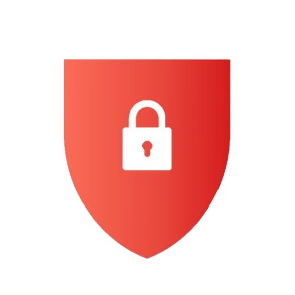
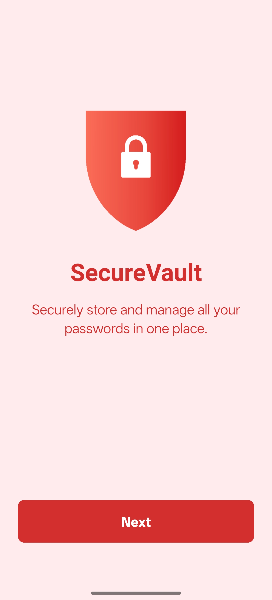
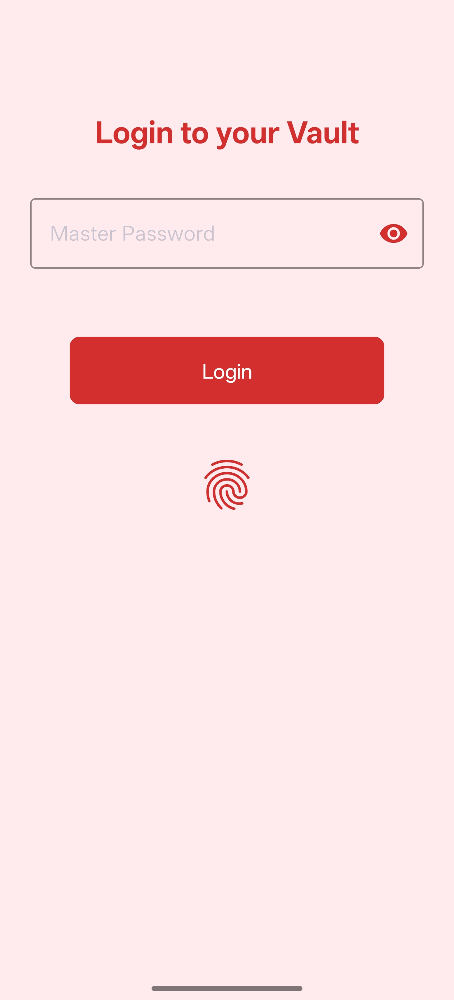
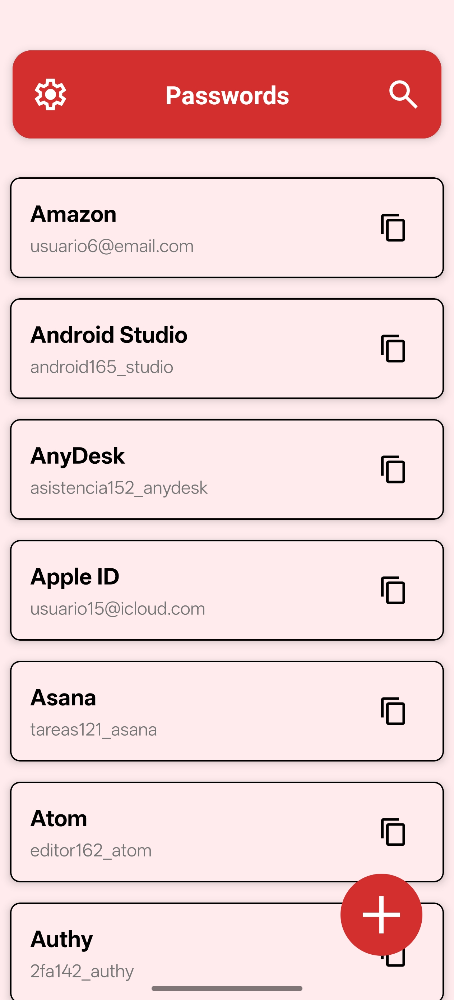

<p align="center">
  
</p>

<h1 align="center">SecureVault</h1>

<p align="center">
  <a href="https://play.google.com/store/apps/details?id=com.enekocm.securevault">
    
  </a>
</p>

<p align="center">
  <strong>An open-source Android application for managing your passwords and sensitive credentials securely.</strong>
</p>

---

### Installation

1.  Go to [Releases](https://github.com/enekocm7/SecureVault/releases).
2.  Download the latest `app-release.apk`.
3.  On your Android phone, enable **Install unknown apps**.
4.  Tap the APK and install it.
5.  Enjoy a secure vault for your secrets.

*(Note: When installing APKs outside of the Play Store, you might see a Play Protect warning. This is expected as Google has not officially scanned the app. Your data is encrypted and secure.)*

---

### Screenshots

<p align="center">
  
  <br>
  <strong>Onboarding Screen</strong>
</p>

<p align="center">
  
  <br>
  <strong>Login Screen</strong>
  <br>
  <em>(Supports master password and biometrics)</em>
</p>

<p align="center">
  
  <br>
  <strong>Password List</strong>
</p>

---

### Key Features

*   **Secure Data Storage**: Your data is encrypted using industry-standard algorithms to keep it private and protected.
*   **Intuitive User Interface**: A clean and straightforward interface makes password management easy.
*   **Strong Password Generation**: Create complex and unique passwords directly within the app.
*   **Offline Accessibility**: Access your vault anytime, anywhere, without an internet connection.

---

### Build with Kargo (Compose UI)

This branch migrates the app from Gradle + XML views to
[Kargo](https://enekocm7.github.io/kargo/) + Jetpack Compose, keeping the UI
1:1 (same `light_red`/`red` theme, same screens, same strings/drawables).

```sh
# one-time: put your Firebase config at android/google-services.json
# (not committed; see .gitignore). Download it from the Firebase console:
# Project settings > Your apps > google-services.json
cp ~/Downloads/google-services.json android/google-services.json

# one-time: accept the Android SDK licenses
kargo toolchain install android-sdk --accept-licenses

# type-check / build the Android app (APK in target/)
kargo check -t android
kargo build -t android
kargo run -t android            # install on a device/emulator
```

Notes:

* UI lives in `app/src/main/java/com/enekocm/securevault/ui/compose/`
  (`theme/`, `components/`, `screens/`, `dialogs/`), one `@Composable`
  per former XML layout, each with a `@Preview`.
* Kargo drives the Android Gradle Plugin for you; there are no
  `build.gradle.kts` / `settings.gradle.kts` files to edit — configure
  everything in `kargo.toml`.
* DI is Hilt: `SecureVaultApp` is `@HiltAndroidApp`, bindings live in
  `src/di/*` (`@Module @InstallIn(SingletonComponent::class)`), ViewModels
  are `@HiltViewModel` and Activities/Fragments/Services are
  `@AndroidEntryPoint` (`by viewModels()` with no factories). The Hilt
  Gradle plugin is applied via `[target.android.plugins]` in `kargo.toml`
  (version matches `com.google.dagger:hilt-android` in `[dependencies]`,
  processor `com.google.dagger:hilt-compiler` with `scope = "ksp"`).
  The `crashlytics` plugin is applied the same way
  (`com.google.firebase.crashlytics` 3.0.2): it is required because the app
  depends on `firebase-crashlytics`, whose SDK crashes at startup without
  its Gradle plugin stamping a build ID.
* Firebase is wired via the `google-services` Gradle plugin (also under
  `[target.android.plugins]`): Kargo copies `android/google-services.json`
  into the generated Gradle module, so `Firebase.auth` / `Firebase.firestore`
  work and `default_web_client_id` is generated from the json — no manual
  string resource needed. Without that file the build still succeeds but the
  app runs fully offline (cloud sync / Google sign-in disabled, local vault
  unaffected). For cloud features, place the real file at
  `android/google-services.json` before building; CI should provide it as
  a secret.

---

### License

This project is licensed under the [MIT License](LICENSE).
